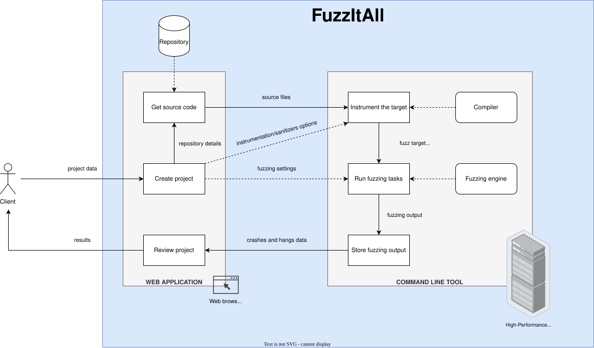

# FuzzItAll

A platform to ease the working process of grey-box fuzzing using the capabilities of a High-Performance Computing (HPC) system.

## Overview

The project is organized as follows:

    .
    ├── cli_tool/       # Command line tool to run grey-box fuzzing engines on an HPC system
    ├── web_app/        # Web application to request the creation of projects containing fuzz targets
    ├── docs/           # Project documentation
    └── LICENSE.md      # Software license file

The operation of the platform is based on two components: a [command line tool](cli_tool/README.md) that acts as a backend and a [web application](web_app/README.md) acting as a frontend. For more information, see their corresponding directories.

## Versioning

We use [SemVer](http://semver.org/) for versioning. For the versions available, see the [tags on this repository](https://niebla.unileon.es/securecoding/fuzzitall/tags).

## Authors

* **Gonzalo Esteban** - *Lead developer* - [gonestco](https://github.com/gonestco)
* **David Fernández** - *Initial work* - [litios](https://github.com/litios)
* **Francisco Borja Garnelo** - *Original concept* - [b0rh](https://github.com/b0rh)

## License

This project is licensed under the MIT License - see the [LICENSE.md](LICENSE.md) file for details.

## Acknowledgments

* This project has been funded by the Addendums no. 4 and no. 8 to the Universidad de León-Instituto Nacional de Ciberseguridad (INCIBE) Convention Framework on the "Detection of new threats and unknown patterns".
