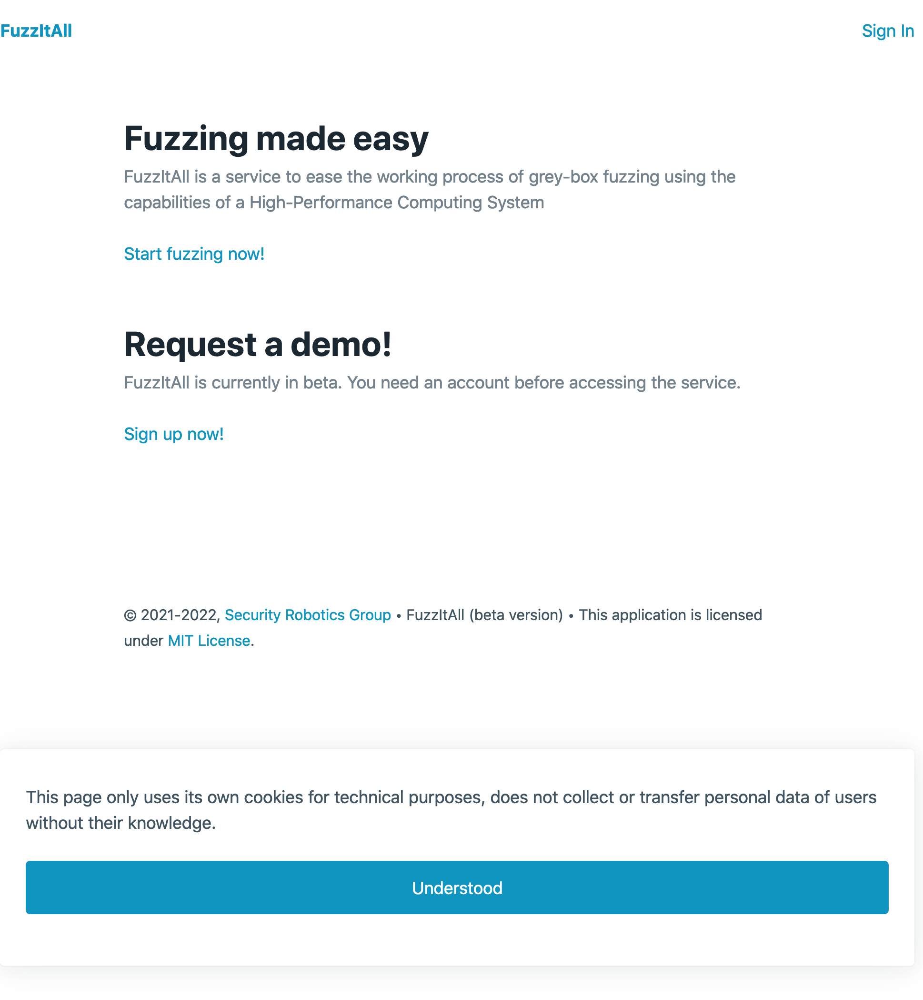

# FuzzItAll (web application)

Web application for requesting fuzzing tasks on a running HPC system. This application acts as a frontend to the FuzzItAll service.

## Getting Started

These instructions will get you a copy of the project up and running on your local machine for development and testing purposes. See [deployment section](#deployment) for notes on how to deploy the project on a live system.

### Prerequisites

The project includes a file (see [requirements.txt](requirements.txt)) with all the dependencies. To install them just run:

```
pip install -r requirements.txt
```

### Installing

You must first create some environment variables. If your are running a Linux system, you need to run:

```
export FLASK_APP="entrypoint"
export FLASK_ENV="development"
export APP_SETTINGS_MODULE="config.development"
```

And if you are running Windows, run:

```
set "FLASK_APP=entrypoint"
set "FLASK_ENV=development"
set "APP_SETTINGS_MODULE=config.development"
```

Next, you must recreate the database structure and create the default administration user. To do this, run the following commands:

```
flask create-db
flask create-admin
```

Finally, you can start the web application by running:

```
flask run
```

Then go to a browser and type http://127.0.0.1:5000. You should see a page like the following:



To access the application, the default user is `admin` and the password is the one you entered when creating the user.

## Running the tests

The project uses the [unittest](https://docs.python.org/3/library/unittest.html) framework to run the automatic tests. To run all tests, type:

```
python -m unittest
```

TODO: break down into end-2-end tests

## Deployment

The following instructions allow you to deploy the web service on a production server. To facilitate the deployment, the service makes use of a [Docker container](https://www.docker.com/resources/what-container/). Having said that, the first step is to build the image using:

```
docker build -t fuzzitall:latest .
```

Once the build has finished, the last step is to run that image on a container by typing:

```
docker run --name fuzzitall -p 80:5000 --rm fuzzitall:latest
```

This will start the web service using port 80 by default. If you want to use a different port, just replace it in the `-p` argument (e.g. `-p 443:5000`). This time, the login credentials are `admin` (username) and `admin` (password).

## Built With

* [Flask](https://palletsprojects.com/p/flask/) - The web framework used.
* [Paramiko](https://www.paramiko.org/) - Used for SSH connections.
* [WTForms](https://wtforms.readthedocs.io/) - Used for forms validation and rendering.

## Credits

See parent [README.md](../README.md) file.